<p style="color: red; font-weight: bold">>>>>>  gd2md-html alert:  ERRORs: 0; WARNINGs: 0; ALERTS: 16.</p>
<ul style="color: red; font-weight: bold"><li>See top comment block for details on ERRORs and WARNINGs. <li>In the converted Markdown or HTML, search for inline alerts that start with >>>>>  gd2md-html alert:  for specific instances that need correction.</ul>

<p style="color: red; font-weight: bold">Links to alert messages:</p><a href="#gdcalert1">alert1</a>
<a href="#gdcalert2">alert2</a>
<a href="#gdcalert3">alert3</a>
<a href="#gdcalert4">alert4</a>
<a href="#gdcalert5">alert5</a>
<a href="#gdcalert6">alert6</a>
<a href="#gdcalert7">alert7</a>
<a href="#gdcalert8">alert8</a>
<a href="#gdcalert9">alert9</a>
<a href="#gdcalert10">alert10</a>
<a href="#gdcalert11">alert11</a>
<a href="#gdcalert12">alert12</a>
<a href="#gdcalert13">alert13</a>
<a href="#gdcalert14">alert14</a>
<a href="#gdcalert15">alert15</a>
<a href="#gdcalert16">alert16</a>

<p style="color: red; font-weight: bold">>>>>> PLEASE check and correct alert issues and delete this message and the inline alerts.<hr></p>


**Задание 1**

Дана схема для Cisco Packet Tracer, рассматриваемая в лекции.

На данной схеме уже настроено отслеживание интерфейсов маршрутизаторов Gi0/1 (для нулевой группы)

Необходимо аналогично настроить отслеживание состояния интерфейсов Gi0/0 (для первой группы).

Для проверки корректности настройки, разорвите один из кабелей между одним из маршрутизаторов и Switch0 и запустите ping между PC0 и Server0.

Отправьте получившуюся схему в формате pkt и скриншот, где виден процесс настройки маршрутизатора.


<p id="gdcalert1" ><span style="color: red; font-weight: bold">>>>>>  gd2md-html alert: inline image link here (to images/image1.png). Store image on your image server and adjust path/filename/extension if necessary. </span><br>(<a href="#">Back to top</a>)(<a href="#gdcalert2">Next alert</a>)<br><span style="color: red; font-weight: bold">>>>>> </span></p>


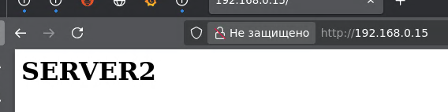


Настройка отслеживания на Router0 (для Group 0) 


```
Router0# configure terminal 
Router0(config)# interface GigabitEthernet 0/0 
Router0(config-if)# standby 0 track GigabitEthernet 0/1 
```


Настройка отслеживания на Router1 (для Group 0) 


```
Router1# configure terminal 
Router1(config)# interface GigabitEthernet 0/0 
Router1(config-if)# standby 0 track GigabitEthernet 0/1 
```


```
Пример:
Выставить приоритет:
standby 1 priority 95 
перехват
standby 1 preempt 
```


Настроена полноценная отказоустойчивая схема с балансировкой трафика (Load Balancing) между двумя маршрутизаторами.


<p id="gdcalert2" ><span style="color: red; font-weight: bold">>>>>>  gd2md-html alert: inline image link here (to images/image2.png). Store image on your image server and adjust path/filename/extension if necessary. </span><br>(<a href="#">Back to top</a>)(<a href="#gdcalert3">Next alert</a>)<br><span style="color: red; font-weight: bold">>>>>> </span></p>


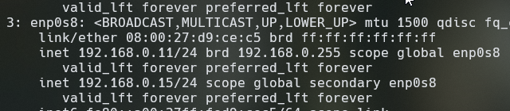


<p id="gdcalert3" ><span style="color: red; font-weight: bold">>>>>>  gd2md-html alert: inline image link here (to images/image3.png). Store image on your image server and adjust path/filename/extension if necessary. </span><br>(<a href="#">Back to top</a>)(<a href="#gdcalert4">Next alert</a>)<br><span style="color: red; font-weight: bold">>>>>> </span></p>


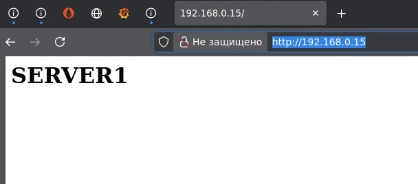


Если у Router0 падает Gi0/1  его приоритет становится 95 -> Router1 (100) становится Active. 

Если у Router1 падает Gi0/0  его приоритет становится 90 -> Router0 (95) становится Active. 


<p id="gdcalert4" ><span style="color: red; font-weight: bold">>>>>>  gd2md-html alert: inline image link here (to images/image4.png). Store image on your image server and adjust path/filename/extension if necessary. </span><br>(<a href="#">Back to top</a>)(<a href="#gdcalert5">Next alert</a>)<br><span style="color: red; font-weight: bold">>>>>> </span></p>


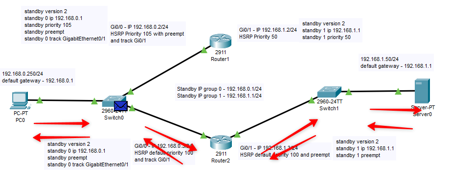


<p id="gdcalert5" ><span style="color: red; font-weight: bold">>>>>>  gd2md-html alert: inline image link here (to images/image5.png). Store image on your image server and adjust path/filename/extension if necessary. </span><br>(<a href="#">Back to top</a>)(<a href="#gdcalert6">Next alert</a>)<br><span style="color: red; font-weight: bold">>>>>> </span></p>


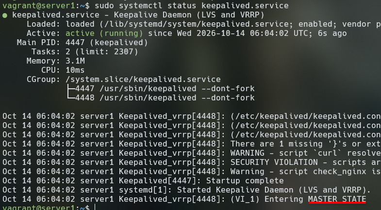


Настроить тренажер с нуля:

Полная настройка Router0

Router0 будет **основным** для Группы 0 и **резервным** для Группы 1.


```
Router> enable
Router# configure terminal

! --- Настройка интерфейса Gig0/0 (Подсеть 0) ---
Router(config)# interface GigabitEthernet 0/0
Router(config-if)# ip address 192.168.0.2 255.255.255.0
Router(config-if)# no shutdown
Router(config-if)# standby 0 ip 192.168.0.1
Router(config-if)# standby 0 priority 105
Router(config-if)# standby 0 preempt
Router(config-if)# standby 0 track GigabitEthernet 0/1
Router(config-if)# exit

! --- Настройка интерфейса Gig0/1 (Подсеть 1) ---
Router(config)# interface GigabitEthernet 0/1
Router(config-if)# ip address 192.168.1.2 255.255.255.0
Router(config-if)# no shutdown
Router(config-if)# standby 1 ip 192.168.1.1
Router(config-if)# standby 1 priority 95
Router(config-if)# standby 1 preempt
Router(config-if)# exit

Router(config)# end
Router# write memory
```


2. Полная настройка Router1

Router1 будет **резервным** для Группы 0 и **основным** для Группы 1.


```
Router> enable
Router# configure terminal

! --- Настройка интерфейса Gig0/0 (Подсеть 0) ---
Router(config)# interface GigabitEthernet 0/0
Router(config-if)# ip address 192.168.0.3 255.255.255.0
Router(config-if)# no shutdown
Router(config-if)# standby 0 ip 192.168.0.1
Router(config-if)# standby 0 priority 100
Router(config-if)# standby 0 preempt
Router(config-if)# standby 0 track GigabitEthernet 0/1
Router(config-if)# exit

! --- Настройка интерфейса Gig0/1 (Подсеть 1) ---
Router(config)# interface GigabitEthernet 0/1
Router(config-if)# ip address 192.168.1.3 255.255.255.0
Router(config-if)# no shutdown
Router(config-if)# standby 1 ip 192.168.1.1
Router(config-if)# standby 1 priority 100
Router(config-if)# standby 1 preempt
Router(config-if)# standby 1 track GigabitEthernet 0/0
Router(config-if)# exit

Router(config)# end
Router# write memory
```


**Задание 2**

Запустите две виртуальные машины Linux, установите и настройте сервис Keepalived как в лекции, используя пример конфигурационного файла.

Настройте любой веб-сервер (например, nginx или simple python server) на двух виртуальных машинах

Напишите Bash-скрипт, который будет проверять доступность порта данного веб-сервера и существование файла index.html в root-директории данного веб-сервера.

Настройте Keepalived так, чтобы он запускал данный скрипт каждые 3 секунды и переносил виртуальный IP на другой сервер, если bash-скрипт завершался с кодом, отличным от нуля (то есть порт веб-сервера был недоступен или отсутствовал index.html). Используйте для этого секцию vrrp_script

Отправьте получившейся bash-скрипт и конфигурационный файл keepalived, а также скриншот с демонстрацией переезда плавающего ip на другой сервер в случае недоступности порта или файла index.html

server1


<p id="gdcalert6" ><span style="color: red; font-weight: bold">>>>>>  gd2md-html alert: inline image link here (to images/image6.png). Store image on your image server and adjust path/filename/extension if necessary. </span><br>(<a href="#">Back to top</a>)(<a href="#gdcalert7">Next alert</a>)<br><span style="color: red; font-weight: bold">>>>>> </span></p>


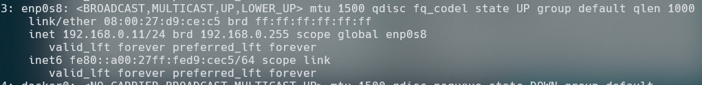


server2


<p id="gdcalert7" ><span style="color: red; font-weight: bold">>>>>>  gd2md-html alert: inline image link here (to images/image7.png). Store image on your image server and adjust path/filename/extension if necessary. </span><br>(<a href="#">Back to top</a>)(<a href="#gdcalert8">Next alert</a>)<br><span style="color: red; font-weight: bold">>>>>> </span></p>


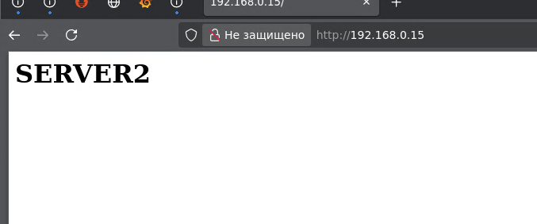


nginx на docker


<p id="gdcalert8" ><span style="color: red; font-weight: bold">>>>>>  gd2md-html alert: inline image link here (to images/image8.png). Store image on your image server and adjust path/filename/extension if necessary. </span><br>(<a href="#">Back to top</a>)(<a href="#gdcalert9">Next alert</a>)<br><span style="color: red; font-weight: bold">>>>>> </span></p>


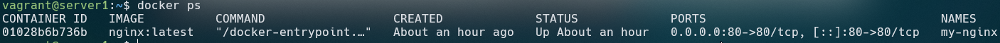


nginx установлен в докер-контейнер, поэтому скрипт будет отличаться

server1


```
# Скрипт проверки доступности Nginx
vrrp_script check_nginx {
    # Проверяем, отвечает ли локальный Nginx на порту 80
    script "curl -s --fail http://localhost:80/ > /dev/null"
    interval 2  # Проверять каждые 2 секунды
    weight -30  # Если проверка провалена, вычесть 30 из приоритета (255 - 30 = 225)
}

vrrp_instance VI_1 {
    state MASTER
    interface enp0s8      
    virtual_router_id 15
    priority 255          # У MASTER приоритет должен быть выше (например, 255)
    advert_int 1

    # Виртуальный IP, который будет «плавать» между машинами
    # ИСПРАВЛЕНО: подсеть должна соответствовать вашей локальной сети (192.168.0.X)
    virtual_ipaddress {
        192.168.0.15/24
    end

    # Подключаем наш скрипт проверки вместо track_process
    track_script {
        check_nginx
    }
}
```


sudo systemctl start keepalived.service


<p id="gdcalert9" ><span style="color: red; font-weight: bold">>>>>>  gd2md-html alert: inline image link here (to images/image9.png). Store image on your image server and adjust path/filename/extension if necessary. </span><br>(<a href="#">Back to top</a>)(<a href="#gdcalert10">Next alert</a>)<br><span style="color: red; font-weight: bold">>>>>> </span></p>


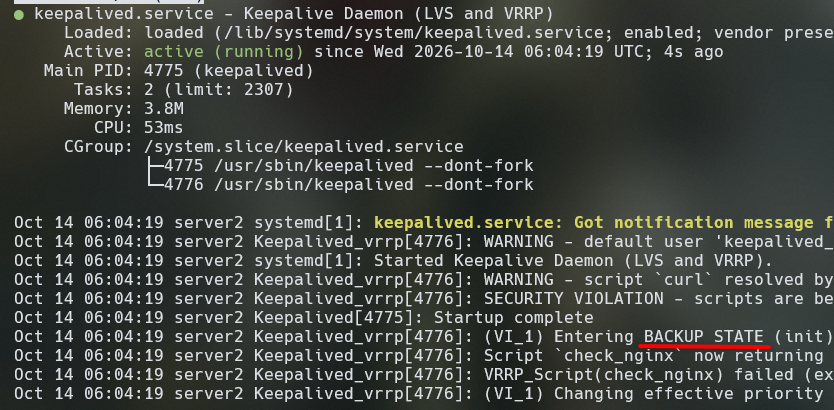


server2


```
vrrp_script check_nginx {
    script "curl -s --fail http://localhost:80/ > /dev/null"
    interval 2
    weight -30
}

vrrp_instance VI_1 {
    state BACKUP          # На второй машине роль — BACKUP
    interface enp0s8
    virtual_router_id 15
    priority 240          # Приоритет ниже, чем у MASTER (240 < 255)
    advert_int 1

    virtual_ipaddress {
        192.168.0.15/24
    }

    track_script {
        check_nginx
    }
}
```


<p id="gdcalert10" ><span style="color: red; font-weight: bold">>>>>>  gd2md-html alert: inline image link here (to images/image10.png). Store image on your image server and adjust path/filename/extension if necessary. </span><br>(<a href="#">Back to top</a>)(<a href="#gdcalert11">Next alert</a>)<br><span style="color: red; font-weight: bold">>>>>> </span></p>


Из-за того что nginx находится в контейнере необходимо исправить конфигураци. keepalive:

server1


```
global_defs {
    enable_script_security
    script_user root
}

# Скрипт проверки доступности Nginx
vrrp_script check_nginx {
    # Проверяем, отвечает ли локальный Nginx на порту 80
    script "/bin/sh -c '/usr/bin/curl -s --fail http://localhost:80/ > /dev/null'"
    interval 2  # Проверять каждые 2 секунды
    weight -30  # Если проверка провалена, вычесть 30 из приоритета (255 - 30 = 225)
}

vrrp_instance VI_1 {
    state MASTER
    interface enp0s8
    virtual_router_id 15
    priority 245          # У MASTER приоритет должен быть выше
    advert_int 1

    # Виртуальный IP, который будет «плавать» между машинами
    # ИСПРАВЛЕНО: подсеть должна соответствовать вашей локальной сети (192.168.0.X)
    virtual_ipaddress {
        192.168.0.15/24
    }

    # Подключаем наш скрипт проверки вместо track_process
    track_script {
        check_nginx
    }
}

```


server2:


```
global_defs {
    enable_script_security
    script_user root
}

vrrp_script check_nginx {
    script "/bin/sh -c '/usr/bin/curl -s --fail http://localhost:80/ > /dev/null'"
    interval 2
    weight -30
}

vrrp_instance VI_1 {
    state BACKUP          # На второй машине роль — BACKUP
    interface enp0s8
    virtual_router_id 15
    priority 230          # Приоритет ниже, чем у MASTER (230 < 240)
    advert_int 1

    virtual_ipaddress {
        192.168.0.15/24
    }

    track_script {
        check_nginx
    }
}

```


<p id="gdcalert11" ><span style="color: red; font-weight: bold">>>>>>  gd2md-html alert: inline image link here (to images/image11.png). Store image on your image server and adjust path/filename/extension if necessary. </span><br>(<a href="#">Back to top</a>)(<a href="#gdcalert12">Next alert</a>)<br><span style="color: red; font-weight: bold">>>>>> </span></p>


192.168.0.15 - виртуальный адрес


<p id="gdcalert12" ><span style="color: red; font-weight: bold">>>>>>  gd2md-html alert: inline image link here (to images/image12.png). Store image on your image server and adjust path/filename/extension if necessary. </span><br>(<a href="#">Back to top</a>)(<a href="#gdcalert13">Next alert</a>)<br><span style="color: red; font-weight: bold">>>>>> </span></p>


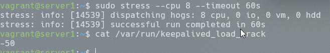


```
docker exec -it my-nginx sh -c "echo '<h1>SERVER1</h1>' > /usr/share/nginx/html/index.html"
docker exec -it my-nginx sh -c "echo '<h1>SERVER2</h1>' > /usr/share/nginx/html/index.html"
```


<p id="gdcalert13" ><span style="color: red; font-weight: bold">>>>>>  gd2md-html alert: inline image link here (to images/image13.png). Store image on your image server and adjust path/filename/extension if necessary. </span><br>(<a href="#">Back to top</a>)(<a href="#gdcalert14">Next alert</a>)<br><span style="color: red; font-weight: bold">>>>>> </span></p>


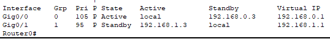


docker stop my-nginx


<p id="gdcalert14" ><span style="color: red; font-weight: bold">>>>>>  gd2md-html alert: inline image link here (to images/image14.png). Store image on your image server and adjust path/filename/extension if necessary. </span><br>(<a href="#">Back to top</a>)(<a href="#gdcalert15">Next alert</a>)<br><span style="color: red; font-weight: bold">>>>>> </span></p>


**Задание 3***

Изучите дополнительно возможность Keepalived, которая называется vrrp_track_file

Напишите bash-скрипт, который будет менять приоритет внутри файла в зависимости от нагрузки на виртуальную машину (можно разместить данный скрипт в cron и запускать каждую минуту). Рассчитывать приоритет можно, например, на основании Load average.

Настройте Keepalived на отслеживание данного файла.

Нагрузите одну из виртуальных машин, которая находится в состоянии MASTER и имеет активный виртуальный IP и проверьте, чтобы через некоторое время она перешла в состояние SLAVE из-за высокой нагрузки и виртуальный IP переехал на другой, менее нагруженный сервер.

Попробуйте выполнить настройку keepalived на третьем сервере и скорректировать при необходимости формулу так, чтобы плавающий ip адрес всегда был прикреплен к серверу, имеющему наименьшую нагрузку.

Отправьте получившийся bash-скрипт и конфигурационный файл keepalived, а также скриншоты логов keepalived с серверов при разных нагрузках

Директива track_file (в старых версиях использовался синоним vrrp_track_file) в Keepalived предназначена для динамического изменения приоритета VRRP-инстанса или перевода его в состояние FAULT на основе содержимого обычного текстового файла.


1. Создадим скрипт для считывания нагрузки

    sudo nano /usr/local/bin/check_load.sh


    ```
#!/bin/bash

# Путь к файлу трекера Keepalived
TRACK_FILE="/var/run/keepalived_load_track"

# Критический порог Load Average (например, 8.0 для 4-8 ядерной системы)
# Подставьте свое значение в зависимости от процессора
MAX_LOAD=2.0

# 1. Получаем Load Average за последнюю 1 минуту (первое число)
# С помощью awk заменяем запятую на точку, если это необходимо
CURRENT_LOAD=$(awk '{print $1}' /proc/loadavg)

# 2. Сравниваем текущий Load Average с критическим порогом (используем bc для чисел с плавающей точкой)
if (( $(echo "$CURRENT_LOAD > $MAX_LOAD" | bc -l) )); then
    # Если перегружен, пишем -50 (это снизит приоритет Keepalived на 50)
    echo "-50" > "$TRACK_FILE"
else
    # Если все в норме, пишем 0 (возвращаем стандартный приоритет)
    echo "0" > "$TRACK_FILE"
fi
```


sudo chmod +x /usr/local/bin/check_load.sh 

sudo crontab -e  #раз в минуту:

* * * * * /usr/local/bin/check_load.sh 

server1:


```
global_defs {
    enable_script_security
    script_user root
}

# Объявляем файл трекера
track_file check_load_file {
    file /var/run/keepalived_load_track   # Путь к нашему файлу
    weight 1                              # Шаг изменения (значение из файла умножается на 1)
}


# Скрипт проверки доступности Nginx
vrrp_script check_nginx {
    # Проверяем, отвечает ли локальный Nginx на порту 80
    script "/bin/sh -c '/usr/bin/curl -s --fail http://localhost:80/ > /dev/null'"
    interval 2  # Проверять каждые 2 секунды
    weight -30  # Если проверка провалена, вычесть 30 из приоритета (255 - 30 = 225)
}

vrrp_instance VI_1 {
    state MASTER
    interface enp0s8
    virtual_router_id 15
    priority 245          # У MASTER приоритет должен быть выше (например, 255)
    advert_int 1

    # Виртуальный IP, который будет «плавать» между машинами
    # ИСПРАВЛЕНО: подсеть должна соответствовать вашей локальной сети (192.168.0.X)
    virtual_ipaddress {
        192.168.0.15/24
    }

    # Подключаем наш скрипт проверки вместо track_process
    track_script {
        check_nginx
    }
    # Подключаем отслеживание файла нагрузки
    track_file {
        check_load_file
    }
}
```


server2:


```
global_defs {
    enable_script_security
    script_user root
}

# Объявляем файл трекера
track_file check_load_file {
    file /var/run/keepalived_load_track   # Путь к нашему файлу
    weight 1                              # Шаг изменения (значение из файла умножается на 1)
}


vrrp_script check_nginx {
    script "/bin/sh -c '/usr/bin/curl -s --fail http://localhost:80/ > /dev/null'"
    interval 2
    weight -30
}

vrrp_instance VI_1 {
    state BACKUP          # На второй машине роль — BACKUP
    interface enp0s8
    virtual_router_id 15
    priority 230          # Приоритет ниже, чем у MASTER (230 < 240)
    advert_int 1

    virtual_ipaddress {
        192.168.0.15/24
    }

    track_script {
        check_nginx
    }
     # Подключаем отслеживание файла нагрузки
    track_file {
        check_load_file
    }
}

```


stress --cpu 2 --timeout 60s 

скрипт считал load average и записал в фаил приоритет:


<p id="gdcalert15" ><span style="color: red; font-weight: bold">>>>>>  gd2md-html alert: inline image link here (to images/image15.png). Store image on your image server and adjust path/filename/extension if necessary. </span><br>(<a href="#">Back to top</a>)(<a href="#gdcalert16">Next alert</a>)<br><span style="color: red; font-weight: bold">>>>>> </span></p>


Keepalive считал содержимое файла и переключил соединение на SERVER2


<p id="gdcalert16" ><span style="color: red; font-weight: bold">>>>>>  gd2md-html alert: inline image link here (to images/image16.png). Store image on your image server and adjust path/filename/extension if necessary. </span><br>(<a href="#">Back to top</a>)(<a href="#gdcalert17">Next alert</a>)<br><span style="color: red; font-weight: bold">>>>>> </span></p>


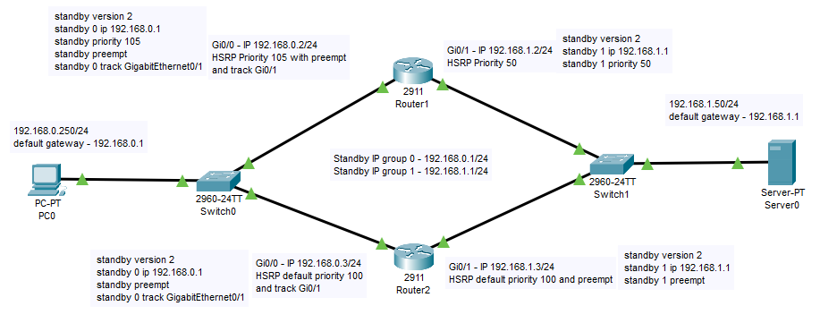


после снижения нагрузки соединение вернулось на SERVER1